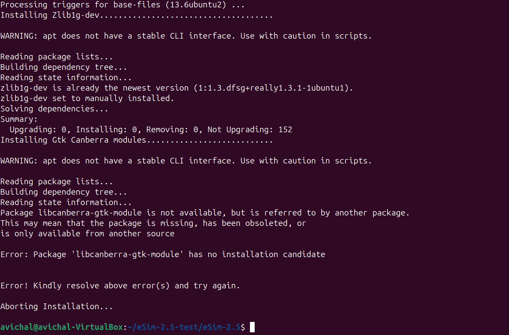
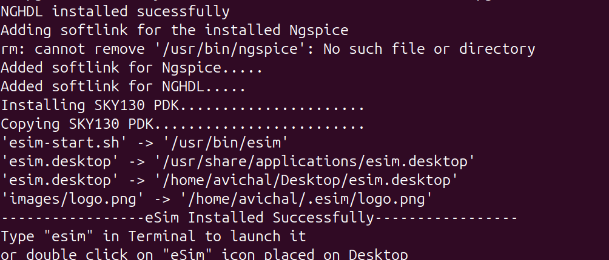
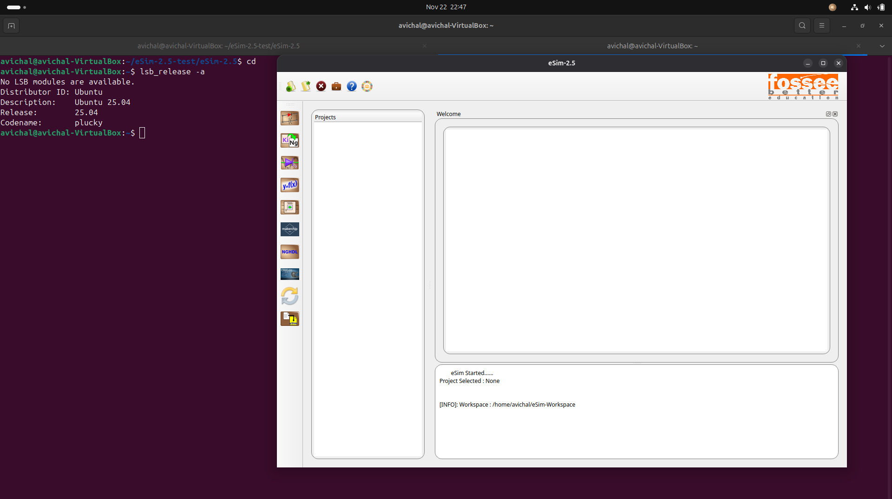

# FOSSEE Screening Task 4: 
eSim 2.5 Installation & Dependency Fixes on Ubuntu 25.04

**TOTAL ISSUES RESOLVED**: 5

**Name**: Avichal Das

**Email**: avichal1108@gmail.com

**College & Course**: Maharaja Surajmal Institute of Technology, New Delhi (B.Tech CSE 2nd year)

**OS**: Ubuntu 25.04 (Virtual machine)

**Github repo link**: https://github.com/avii1103/eSim
___
# BUG-01
- [x] Solved
___
## Error output
This error blocks eSim installation on Ubuntu 25.04 and higher systems
```bash
Detected Ubuntu Version:
Unsupported Ubuntu version: 25.04 ()
```


## Cause for the error
- `case $VERSION_ID` lacked a 25.04 version target
- `grep -oP '\d+\.\d+(\.\d+` could not parse two-part interim Ubuntu release numbers

## FIX
### Process
1. In line 26, made the third version digit optional (updated regex)
```bash
FULL_VERSION=$(lsb_release -d | grep -oP '\d+\.\d+(\.\d+)?')
```
2. Added case block for version 25.04
```bash
"25.04") 
	SCRIPT="$SCRIPT_DIR/install-eSim-25.04.sh" 
	;;
```
### Result: 
The installation proceeded further, asked me whether i was using a proxy or not and i said 'n'.. After this, I entered my sudo password and the installation proceeded until the next error 
___
# BUG-02
- [x] Solved
___
## Error output:


## Cause for the error:
The install script attempts to add `ppa:kicad/kicad-6.0-releases` repository, which returns `404 Not Found`.
Non-24.04 versions fall back to `ppa:kicad/kicad-6.0-releases`, which lacks an Ubuntu plucky release file and triggers an `apt-get update` error which caused the installation to stop.

## FIX
### Process:
1. Remove kicad 6.0 entry from APT 
2. Patch `installKicad` to Use Ubuntu 25.04's Native `kicad` Package (commented out lines 142-153 which were handling the installation of the ppa):
```bash
   # Check if the PPA is already added (Disabled for Ubuntu 25.04 - native kicad is in universe)
# if ! grep -q "^deb .*${kicadppa}" /etc/apt/sources.list /etc/apt/sources.list.d/* 2>/dev/null; then
#     echo "Adding KiCad PPA to local apt repository: $kicadppa"
#     sudo add-apt-repository -y "ppa:$kicadppa"
#     sudo apt-get update
# else
#     echo "KiCad PPA is already present in sources."
# fi

# Install KiCad packages
sudo apt-get install -y --no-install-recommends kicad kicad-footprints kicad-libraries kicad-symbols kicad-templates
```
### Result:
Installation proceeded until the next bug
___
# BUG-03
- [x] Solved
___
## Error Output:


## Cause for the error:
`nghdl/install-nghdl.sh` uses the exact same dispatcher structure as `install-eSim.sh`—it checks `VERSION_ID` against `22.04`, `23.04`, and `24.04`, uses the same three-digit `FULL_VERSION` regex, and aborts with `Unsupported Ubuntu version: 25.04 ()`

## FIX
Editing `nghdl/install-nghdl.sh` manually on disk keeps getting overwritten on the next run as `install-eSim-25.04.sh` unpacks `nghdl.zip` fresh during installation.
Instead, we will try to patch `install-eSim-25.04` to run a command before installation nghdl is installed, but after the zip file is extracted.
### Process:
1. Using `grep -n -C 15 "install-nghdl.sh --install" install-eSim-scripts/install-eSim-25.04.sh` we have found the lines after which the zip is extracted and directory is changed and before the chmod +x operation on the install script of nghdl:


2. Added the following code after the cd command and before the chmod command:
```bash
# Patch unpacked nghdl installer for Ubuntu 25.04 compatibility
cp -f install-nghdl-scripts/install-nghdl-24.04.sh install-nghdl-scripts/install-nghdl-25.04.sh
sed -i 's/\\d+\\.\\d+\\.\\d+/\\d+\\.\\d+(\\.\\d+)?/g' install-nghdl.sh
sed -i 's/"24.04")/"24.04"|"25.04")/g' install-nghdl.sh
```

### Result:
Ran the install script again before stopping at the next error

___
# BUG-04
- [x] Solved
___
## Error output:


## Cause for the error:
Ubuntu 25.04 removed the legacy GTK 2 package `libcanberra-gtk-module` from its repositories and replaced it with the GTK 3 equivalent, `libcanberra-gtk3-module`.

## FIX
We need to add a patch block so `libcanberra-gtk-module` is updated automatically during installation.
### Process:
1. Locate `libcanberra-gtk-module` and check `libcanberra-gtk3-module` Inside `~/eSim-2.5-test/eSim-2.5`, inspect the exact line calling `libcanberra-gtk-module` and verify that `libcanberra-gtk3-module` is available in Ubuntu 25.04's repositories:
```bash 
grep -rn -C 3 "libcanberra" nghdl/install-nghdl-scripts/install-nghdl-25.04.sh
apt-cache policy libcanberra-gtk3-module
```
Output:

2. Add the following patch after the sed patches added for nghdl: `sed -i 's/libcanberra-gtk-module //g' install-nghdl-scripts/install-nghdl-25.04.sh`. This Stripped `libcanberra-gtk-module` via `sed` in `install-eSim-25.04.sh` immediately after unpacking `nghdl.zip`.
___
# BUG-05
- [x] Solved
___
## Error output:


## Cause for the error:
Script fails with `Unhandled version llvm 20.1.2`. Ubuntu 25.04 defaults `/usr/bin/llvm-config` to LLVM 20.1.2, whereas the bundled GHDL 4.1.0 release only supports up to LLVM 18.

## FIX
Because `llvm-18` is still packaged in Ubuntu 25.04's repositories, we can fix this directly by installing `llvm-18` and pointing GHDL's configure flag to `/usr/bin/llvm-config-18` (with an immediate fallback to bypass optional NGHDL if needed).
### Process:
1. Verify `llvm-18` is available in Ubuntu 25.04 with `apt-cache policy llvm-18`.
   Output: Version 1:18.1.8-17 is available as a candidate
2. Fixed Llvm installation inside the patch block created for nghdl by adding two lines after the libcanberra patch for installing and updating the version:
```bash
sed -i 's/libcanberra-gtk-module //g' install-nghdl-scripts/install-nghdl-25.04.sh 
sudo apt install -y llvm-18
sed -i 's|--with-llvm-config=/usr/bin/llvm-config|--with-llvm-config=/usr/bin/llvm-config-18|g' install-nghdl-scripts/install-nghdl-25.04.sh
```
___
# Success
eSim successfully finished installing:


The eSim GUI launched successfully and running on Ubuntu 25.04:

